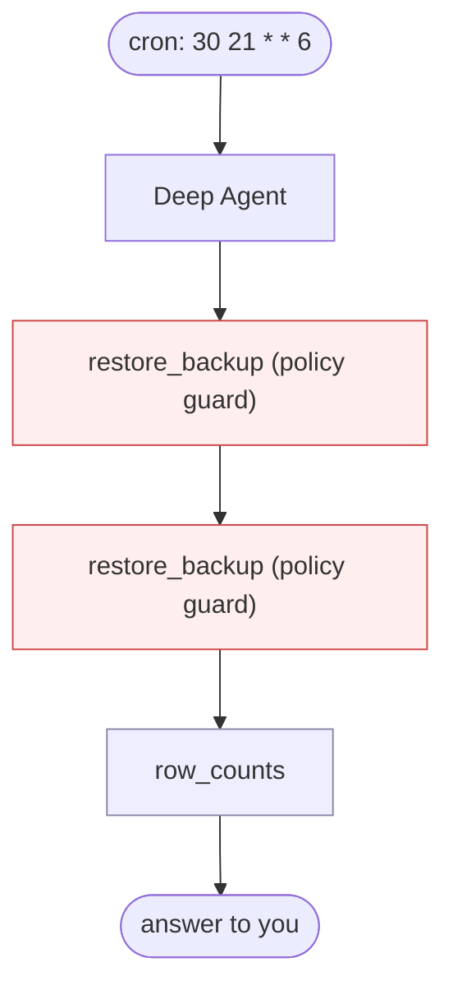

# 086. Backup restore test

**When:** 21:30 (night)  
**Trigger:** `cron: 30 21 * * 6`  
**Type:** DR  
**Deep Agents features:** guardrail

A backup you haven't restored is a guess. The restore target is checked so it never points at prod.

## What you ask

> Restore last night's ledger backup to a scratch DB and verify it.

## Flow



## Tools

| Tool | What it does | Effect | Control |
|---|---|---|---|
| `restore_backup` | Restore a backup to a target DB. | changes state | policy guard |
| `row_counts` | Row counts in a DB. | read-only | - |

## Run it

```bash
python usecases/swe_day/086_backup_restore_test/usecase.py            # offline: scripted model, real Deep Agent
LC_MODEL=anthropic:claude-sonnet-4-6 python usecases/swe_day/086_backup_restore_test/usecase.py --live   # a real model makes the decisions
```

## Taking it to production

- Schedule it with `30 21 * * 6` (cron, server time; prefix `CRON_TZ=...` for your zone). A LangGraph Platform cron job, a GitHub Actions `schedule:`, or a Kubernetes CronJob all work.
- Keep the guard. It's ordinary Python in middleware, so it holds even when the model gets it wrong.
- Swap each `TOOL(..., returns=...)` for a real call (your API, a CLI, or an MCP server through `langchain-mcp-adapters`).
