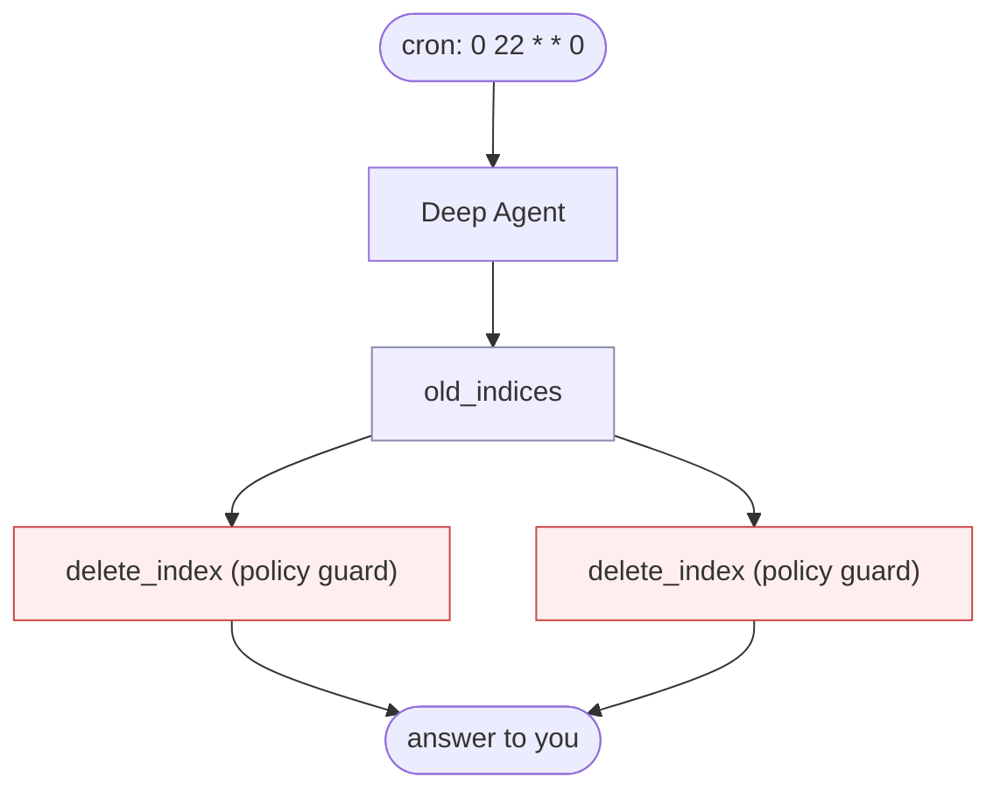

# 087. Log retention cleanup

**When:** 22:00 (night)  
**Trigger:** `cron: 0 22 * * 0`  
**Type:** maintenance  
**Deep Agents features:** guardrail, parallel calls

Deletion is allowed only for debug-level indices; audit logs are blocked.

## What you ask

> Delete debug logs older than 14 days.

## Flow



## Tools

| Tool | What it does | Effect | Control |
|---|---|---|---|
| `old_indices` | Log indices older than N days. | read-only | - |
| `delete_index` | Delete a log index. | changes state | policy guard |

## Run it

```bash
python usecases/swe_day/087_log_retention_cleanup/usecase.py            # offline: scripted model, real Deep Agent
LC_MODEL=anthropic:claude-sonnet-4-6 python usecases/swe_day/087_log_retention_cleanup/usecase.py --live   # a real model makes the decisions
```

## Taking it to production

- Schedule it with `0 22 * * 0` (cron, server time; prefix `CRON_TZ=...` for your zone). A LangGraph Platform cron job, a GitHub Actions `schedule:`, or a Kubernetes CronJob all work.
- Keep the guard. It's ordinary Python in middleware, so it holds even when the model gets it wrong.
- Swap each `TOOL(..., returns=...)` for a real call (your API, a CLI, or an MCP server through `langchain-mcp-adapters`).
