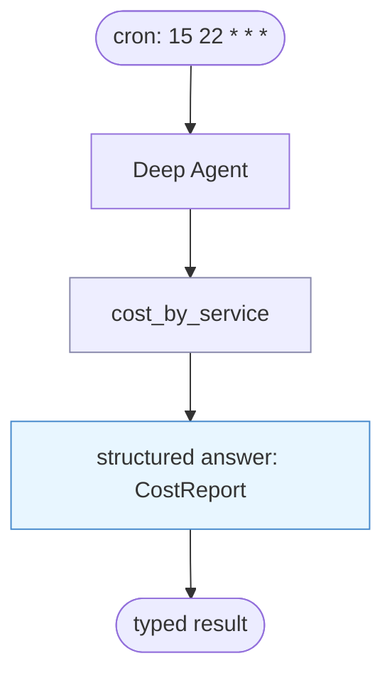

# 088. Nightly cost report

**When:** 22:15 (night)  
**Trigger:** `cron: 15 22 * * *`  
**Type:** FinOps  
**Deep Agents features:** structured output

Structured output feeds a dashboard; the agent just does the gathering.

## What you ask

> Summarise today's cloud spend by service.

## Flow



## Tools

| Tool | What it does | Effect | Control |
|---|---|---|---|
| `cost_by_service` | Spend by service today. | read-only | - |

## Run it

```bash
python usecases/swe_day/088_nightly_cost_report/usecase.py            # offline: scripted model, real Deep Agent
LC_MODEL=anthropic:claude-sonnet-4-6 python usecases/swe_day/088_nightly_cost_report/usecase.py --live   # a real model makes the decisions
```

## Taking it to production

- Schedule it with `15 22 * * *` (cron, server time; prefix `CRON_TZ=...` for your zone). A LangGraph Platform cron job, a GitHub Actions `schedule:`, or a Kubernetes CronJob all work.
- The `CostReport` result is a Pydantic object, so you can post it straight to a dashboard or database.
- Swap each `TOOL(..., returns=...)` for a real call (your API, a CLI, or an MCP server through `langchain-mcp-adapters`).
