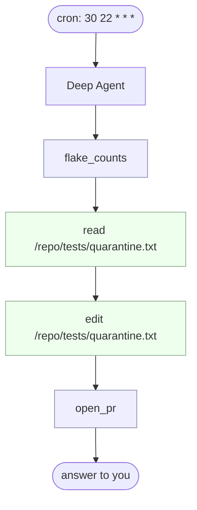

# 089. Quarantine flaky tests

**When:** 22:30 (night)  
**Trigger:** `cron: 30 22 * * *`  
**Type:** CI hygiene  
**Deep Agents features:** filesystem

Edits the quarantine list file and opens a PR. People decide whether to fix or delete.

## What you ask

> Quarantine tests that flaked more than 3 times this week.

## Flow



## Tools

| Tool | What it does | Effect | Control |
|---|---|---|---|
| `flake_counts` | Flake counts this week. | read-only | - |
| `open_pr` | Open a PR. | sends something outside | - |

## Run it

```bash
python usecases/swe_day/089_flaky_test_quarantine/usecase.py            # offline: scripted model, real Deep Agent
LC_MODEL=anthropic:claude-sonnet-4-6 python usecases/swe_day/089_flaky_test_quarantine/usecase.py --live   # a real model makes the decisions
```

## Taking it to production

- Schedule it with `30 22 * * *` (cron, server time; prefix `CRON_TZ=...` for your zone). A LangGraph Platform cron job, a GitHub Actions `schedule:`, or a Kubernetes CronJob all work.
- Swap each `TOOL(..., returns=...)` for a real call (your API, a CLI, or an MCP server through `langchain-mcp-adapters`).
