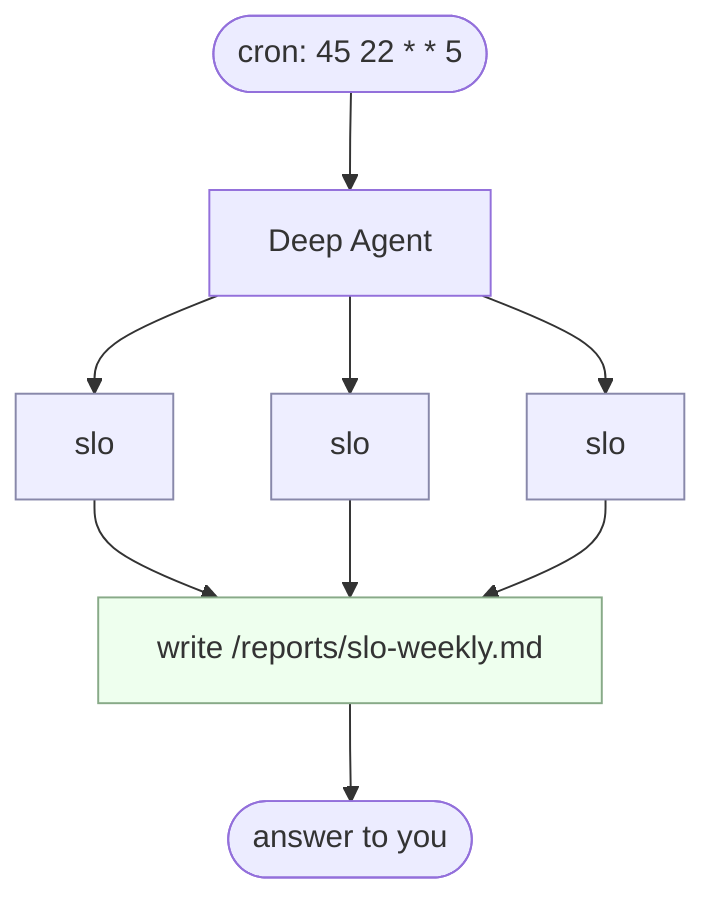

# 090. Weekly SLO report

**When:** 22:45 (night)  
**Trigger:** `cron: 45 22 * * 5`  
**Type:** reporting  
**Deep Agents features:** filesystem, parallel calls

Pulls all SLOs in parallel and writes a report people actually skim.

## What you ask

> Write the weekly SLO report.

## Flow



## Tools

| Tool | What it does | Effect | Control |
|---|---|---|---|
| `slo` | SLO attainment for a service this week. | read-only | - |

## Run it

```bash
python usecases/swe_day/090_weekly_slo_report/usecase.py            # offline: scripted model, real Deep Agent
LC_MODEL=anthropic:claude-sonnet-4-6 python usecases/swe_day/090_weekly_slo_report/usecase.py --live   # a real model makes the decisions
```

## Taking it to production

- Schedule it with `45 22 * * 5` (cron, server time; prefix `CRON_TZ=...` for your zone). A LangGraph Platform cron job, a GitHub Actions `schedule:`, or a Kubernetes CronJob all work.
- Swap each `TOOL(..., returns=...)` for a real call (your API, a CLI, or an MCP server through `langchain-mcp-adapters`).
