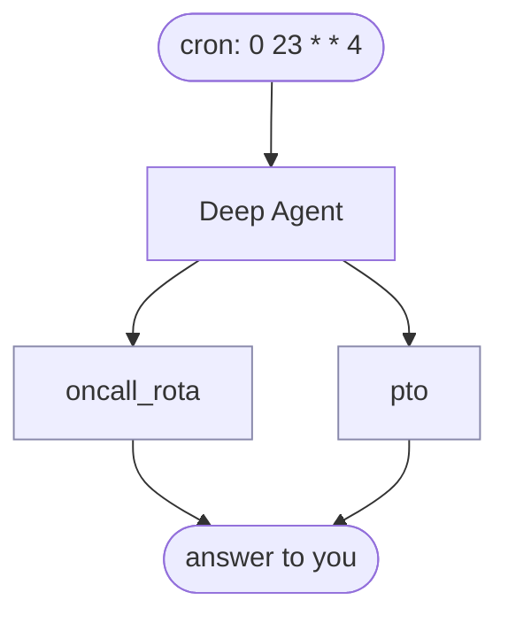

# 091. On-call schedule gap check

**When:** 23:00 (night)  
**Trigger:** `cron: 0 23 * * 4`  
**Type:** scheduling  
**Deep Agents features:** parallel calls

Cross-checks the rota against PTO so nobody finds the gap at 3am.

## What you ask

> Any gaps or conflicts in next week's on-call?

## Flow



## Tools

| Tool | What it does | Effect | Control |
|---|---|---|---|
| `oncall_rota` | Next week's rota. | read-only | - |
| `pto` | PTO next week. | read-only | - |

## Run it

```bash
python usecases/swe_day/091_oncall_schedule_check/usecase.py            # offline: scripted model, real Deep Agent
LC_MODEL=anthropic:claude-sonnet-4-6 python usecases/swe_day/091_oncall_schedule_check/usecase.py --live   # a real model makes the decisions
```

## Taking it to production

- Schedule it with `0 23 * * 4` (cron, server time; prefix `CRON_TZ=...` for your zone). A LangGraph Platform cron job, a GitHub Actions `schedule:`, or a Kubernetes CronJob all work.
- Swap each `TOOL(..., returns=...)` for a real call (your API, a CLI, or an MCP server through `langchain-mcp-adapters`).
