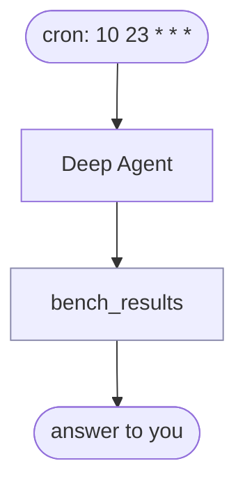

# 092. Benchmark regression check

**When:** 23:10 (night)  
**Trigger:** `cron: 10 23 * * *`  
**Type:** performance  
**Deep Agents features:** 

Compares tonight's benchmark run with the 7-day median.

## What you ask

> Did any benchmark regress more than 10% today?

## Flow



## Tools

| Tool | What it does | Effect | Control |
|---|---|---|---|
| `bench_results` | Benchmark results vs 7-day median. | read-only | - |

## Run it

```bash
python usecases/swe_day/092_benchmark_regression_check/usecase.py            # offline: scripted model, real Deep Agent
LC_MODEL=anthropic:claude-sonnet-4-6 python usecases/swe_day/092_benchmark_regression_check/usecase.py --live   # a real model makes the decisions
```

## Taking it to production

- Schedule it with `10 23 * * *` (cron, server time; prefix `CRON_TZ=...` for your zone). A LangGraph Platform cron job, a GitHub Actions `schedule:`, or a Kubernetes CronJob all work.
- Swap each `TOOL(..., returns=...)` for a real call (your API, a CLI, or an MCP server through `langchain-mcp-adapters`).
