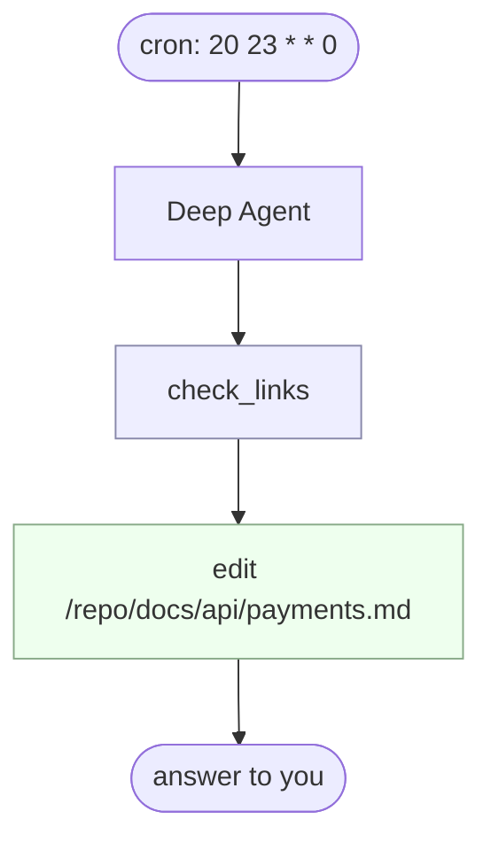

# 093. Broken docs link checker

**When:** 23:20 (night)  
**Trigger:** `cron: 20 23 * * 0`  
**Type:** docs  
**Deep Agents features:** filesystem

Fixes the ones with an obvious redirect, lists the rest.

## What you ask

> Find and fix broken links in docs/.

## Flow



## Tools

| Tool | What it does | Effect | Control |
|---|---|---|---|
| `check_links` | Check links in docs. | read-only | - |

## Run it

```bash
python usecases/swe_day/093_docs_link_checker/usecase.py            # offline: scripted model, real Deep Agent
LC_MODEL=anthropic:claude-sonnet-4-6 python usecases/swe_day/093_docs_link_checker/usecase.py --live   # a real model makes the decisions
```

## Taking it to production

- Schedule it with `20 23 * * 0` (cron, server time; prefix `CRON_TZ=...` for your zone). A LangGraph Platform cron job, a GitHub Actions `schedule:`, or a Kubernetes CronJob all work.
- Swap each `TOOL(..., returns=...)` for a real call (your API, a CLI, or an MCP server through `langchain-mcp-adapters`).
