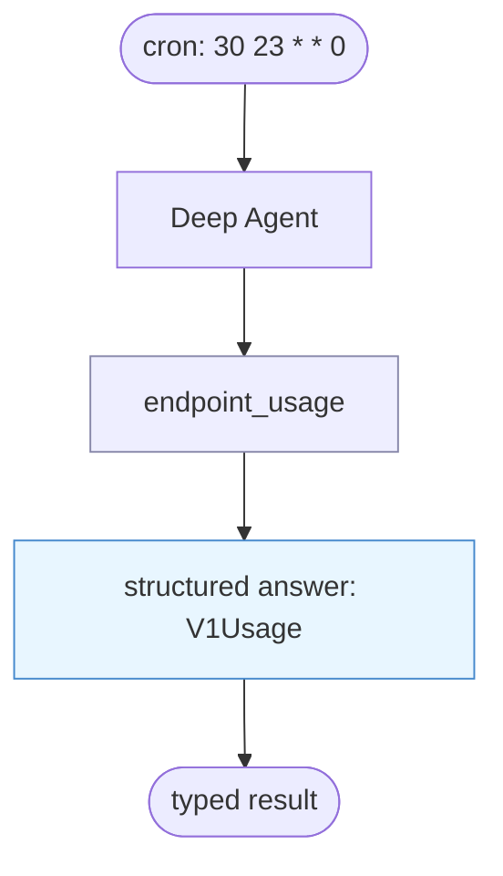

# 094. API usage analytics

**When:** 23:30 (night)  
**Trigger:** `cron: 30 23 * * 0`  
**Type:** analytics  
**Deep Agents features:** structured output

Tells you which clients to chase before turning v1 off.

## What you ask

> Who still calls the deprecated v1 endpoints?

## Flow



## Tools

| Tool | What it does | Effect | Control |
|---|---|---|---|
| `endpoint_usage` | Calls per client for an endpoint prefix. | read-only | - |

## Run it

```bash
python usecases/swe_day/094_api_usage_analytics/usecase.py            # offline: scripted model, real Deep Agent
LC_MODEL=anthropic:claude-sonnet-4-6 python usecases/swe_day/094_api_usage_analytics/usecase.py --live   # a real model makes the decisions
```

## Taking it to production

- Schedule it with `30 23 * * 0` (cron, server time; prefix `CRON_TZ=...` for your zone). A LangGraph Platform cron job, a GitHub Actions `schedule:`, or a Kubernetes CronJob all work.
- The `V1Usage` result is a Pydantic object, so you can post it straight to a dashboard or database.
- Swap each `TOOL(..., returns=...)` for a real call (your API, a CLI, or an MCP server through `langchain-mcp-adapters`).
