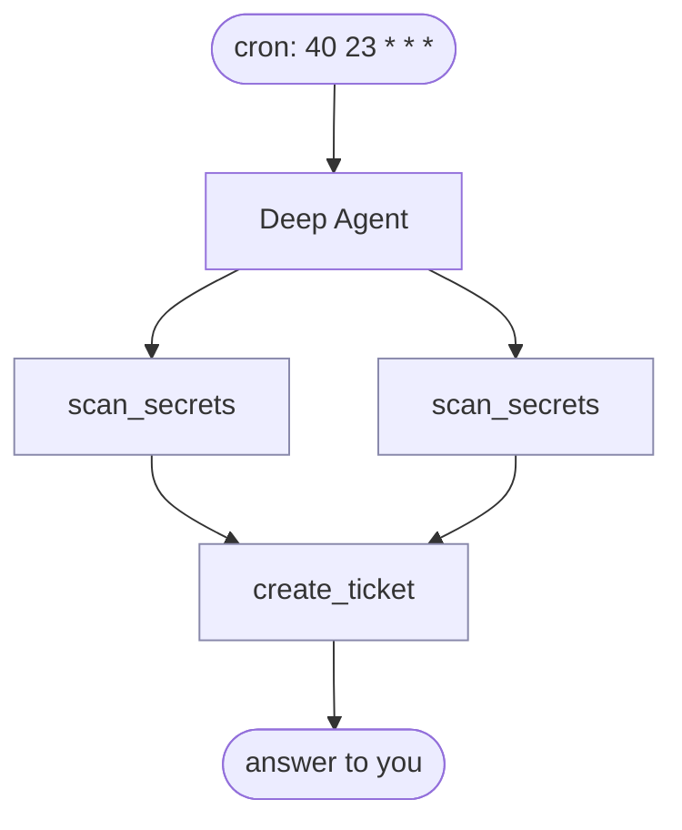

# 095. Nightly secrets scan across repos

**When:** 23:40 (night)  
**Trigger:** `cron: 40 23 * * *`  
**Type:** security  
**Deep Agents features:** parallel calls

Opening a security ticket is allowed; the raw secret value never leaves the scan tool.

## What you ask

> Scan all team repos for committed secrets.

## Flow



## Tools

| Tool | What it does | Effect | Control |
|---|---|---|---|
| `scan_secrets` | Scan a repo for secrets. | read-only | - |
| `create_ticket` | Create a ticket. | changes state | - |

## Run it

```bash
python usecases/swe_day/095_secrets_scan_repos/usecase.py            # offline: scripted model, real Deep Agent
LC_MODEL=anthropic:claude-sonnet-4-6 python usecases/swe_day/095_secrets_scan_repos/usecase.py --live   # a real model makes the decisions
```

## Taking it to production

- Schedule it with `40 23 * * *` (cron, server time; prefix `CRON_TZ=...` for your zone). A LangGraph Platform cron job, a GitHub Actions `schedule:`, or a Kubernetes CronJob all work.
- Swap each `TOOL(..., returns=...)` for a real call (your API, a CLI, or an MCP server through `langchain-mcp-adapters`).
