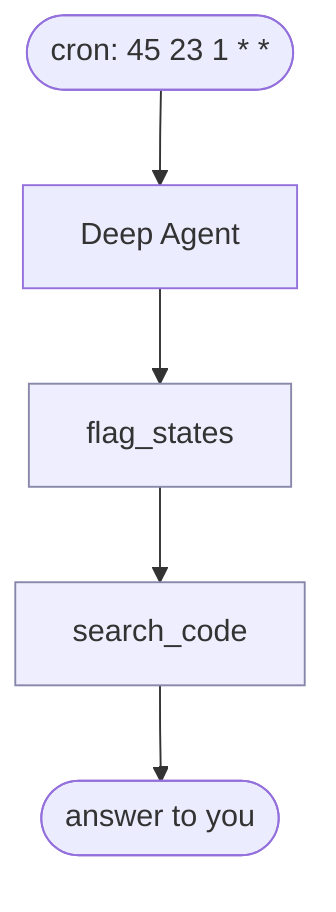

# 096. Unused feature flag report

**When:** 23:45 (night)  
**Trigger:** `cron: 45 23 1 * *`  
**Type:** cleanup  
**Deep Agents features:** 

Flags pile up. This finds the dead ones and where they live in code.

## What you ask

> Which feature flags are 100% on everywhere and can be removed from code?

## Flow



## Tools

| Tool | What it does | Effect | Control |
|---|---|---|---|
| `flag_states` | All flags and rollout per env. | read-only | - |
| `search_code` | Search code. | read-only | - |

## Run it

```bash
python usecases/swe_day/096_unused_feature_flags/usecase.py            # offline: scripted model, real Deep Agent
LC_MODEL=anthropic:claude-sonnet-4-6 python usecases/swe_day/096_unused_feature_flags/usecase.py --live   # a real model makes the decisions
```

## Taking it to production

- Schedule it with `45 23 1 * *` (cron, server time; prefix `CRON_TZ=...` for your zone). A LangGraph Platform cron job, a GitHub Actions `schedule:`, or a Kubernetes CronJob all work.
- Swap each `TOOL(..., returns=...)` for a real call (your API, a CLI, or an MCP server through `langchain-mcp-adapters`).
