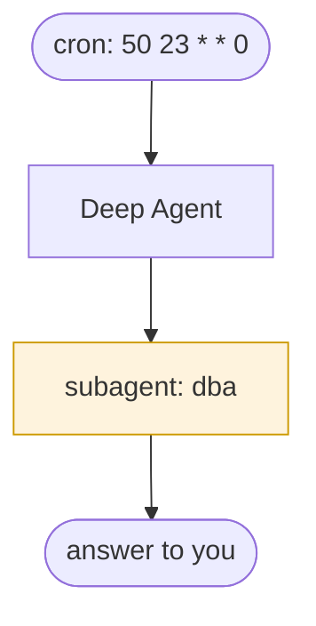

# 097. Database index recommendations

**When:** 23:50 (night)  
**Trigger:** `cron: 50 23 * * 0`  
**Type:** performance  
**Deep Agents features:** subagents

A DBA subagent works through pg_stat_statements in its own context.

## What you ask

> Recommend indexes from this week's slow queries.

## Flow



## Tools

| Tool | What it does | Effect | Control |
|---|---|---|---|
| `top_slow_queries` | Top slow queries this week. | read-only | - |
| `existing_indexes` | Indexes on a table. | read-only | - |

## Subagents

- **dba**: Reviews query stats and recommends indexes. Tools: `top_slow_queries`, `existing_indexes`.

## Run it

```bash
python usecases/swe_day/097_db_index_recommendations/usecase.py            # offline: scripted model, real Deep Agent
LC_MODEL=anthropic:claude-sonnet-4-6 python usecases/swe_day/097_db_index_recommendations/usecase.py --live   # a real model makes the decisions
```

## Taking it to production

- Schedule it with `50 23 * * 0` (cron, server time; prefix `CRON_TZ=...` for your zone). A LangGraph Platform cron job, a GitHub Actions `schedule:`, or a Kubernetes CronJob all work.
- Subagents run in their own context window, which keeps the main thread small. Give them a cheaper model if the job is just reading.
- Swap each `TOOL(..., returns=...)` for a real call (your API, a CLI, or an MCP server through `langchain-mcp-adapters`).
