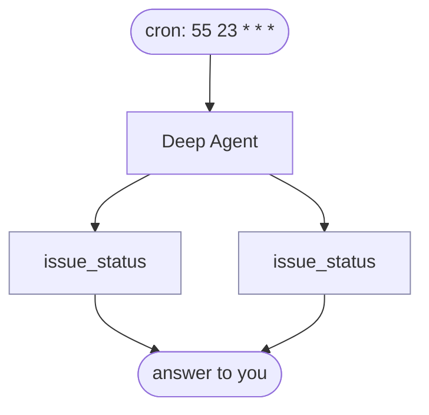

# 098. Watch upstream OSS issues we depend on

**When:** 23:55 (night)  
**Trigger:** `cron: 55 23 * * *`  
**Type:** monitoring  
**Deep Agents features:** parallel calls

Checks issues you starred so you hear when a fix lands.

## What you ask

> Any news on the upstream issues we're tracking?

## Flow



## Tools

| Tool | What it does | Effect | Control |
|---|---|---|---|
| `issue_status` | Status of a GitHub issue. | read-only | - |

## Run it

```bash
python usecases/swe_day/098_upstream_issue_watcher/usecase.py            # offline: scripted model, real Deep Agent
LC_MODEL=anthropic:claude-sonnet-4-6 python usecases/swe_day/098_upstream_issue_watcher/usecase.py --live   # a real model makes the decisions
```

## Taking it to production

- Schedule it with `55 23 * * *` (cron, server time; prefix `CRON_TZ=...` for your zone). A LangGraph Platform cron job, a GitHub Actions `schedule:`, or a Kubernetes CronJob all work.
- Swap each `TOOL(..., returns=...)` for a real call (your API, a CLI, or an MCP server through `langchain-mcp-adapters`).
