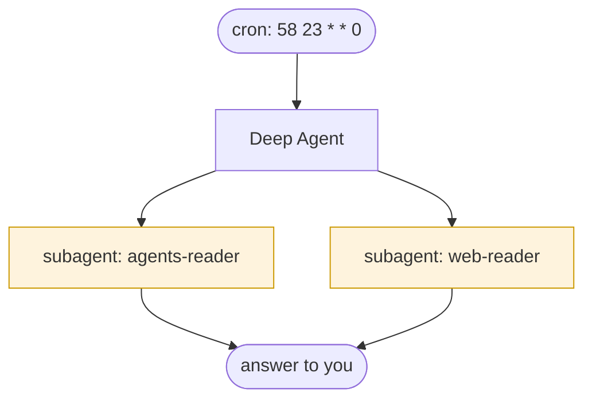

# 099. Weekly digest of tool releases

**When:** 23:58 (night)  
**Trigger:** `cron: 58 23 * * 0`  
**Type:** learning  
**Deep Agents features:** subagents, parallel calls

Two researcher subagents read release notes; you get the 3 lines that matter.

## What you ask

> What changed this week in the tools we use?

## Flow



## Tools

| Tool | What it does | Effect | Control |
|---|---|---|---|
| `release_notes` | Latest release notes for a project. | read-only | - |

## Subagents

- **agents-reader**: Reads agent framework releases. Tools: `release_notes`.
- **web-reader**: Reads web framework releases. Tools: `release_notes`.

## Run it

```bash
python usecases/swe_day/099_tool_release_digest/usecase.py            # offline: scripted model, real Deep Agent
LC_MODEL=anthropic:claude-sonnet-4-6 python usecases/swe_day/099_tool_release_digest/usecase.py --live   # a real model makes the decisions
```

## Taking it to production

- Schedule it with `58 23 * * 0` (cron, server time; prefix `CRON_TZ=...` for your zone). A LangGraph Platform cron job, a GitHub Actions `schedule:`, or a Kubernetes CronJob all work.
- Subagents run in their own context window, which keeps the main thread small. Give them a cheaper model if the job is just reading.
- Swap each `TOOL(..., returns=...)` for a real call (your API, a CLI, or an MCP server through `langchain-mcp-adapters`).
