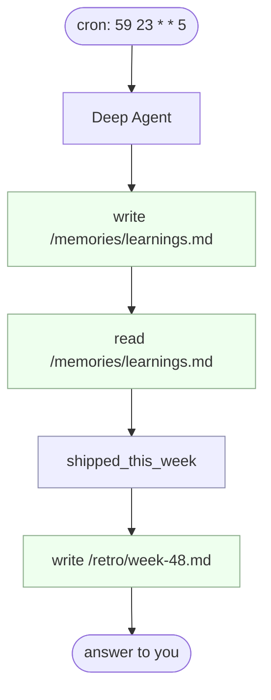

# 100. Weekly retro draft

**When:** 23:59 (night)  
**Trigger:** `cron: 59 23 * * 5`  
**Type:** reflection  
**Deep Agents features:** long-term memory, filesystem

Reads the week's learnings from long-term memory and the shipped work, and drafts the retro for Monday.

## What you ask

> Draft my weekly retro.

## Flow



## Tools

| Tool | What it does | Effect | Control |
|---|---|---|---|
| `shipped_this_week` | Work shipped this week. | read-only | - |

## Run it

```bash
python usecases/swe_day/100_weekly_retro_draft/usecase.py            # offline: scripted model, real Deep Agent
LC_MODEL=anthropic:claude-sonnet-4-6 python usecases/swe_day/100_weekly_retro_draft/usecase.py --live   # a real model makes the decisions
```

## Taking it to production

- Schedule it with `59 23 * * 5` (cron, server time; prefix `CRON_TZ=...` for your zone). A LangGraph Platform cron job, a GitHub Actions `schedule:`, or a Kubernetes CronJob all work.
- `/memories/` maps to a LangGraph store. Use `PostgresStore` so the next run (or tomorrow's) can read it.
- Swap each `TOOL(..., returns=...)` for a real call (your API, a CLI, or an MCP server through `langchain-mcp-adapters`).
