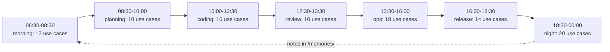

# A software engineer's day on Deep Agents

100 use cases, one folder each, covering one backend engineer's day from 06:30 to midnight. The
engineer works on a payments platform (payments-api, ledger, checkout). Most of these jobs run on
their own: a cron schedule or a webhook starts them, and a person is pulled in only where a decision
needs one. The rest are things you'd ask for at your desk.

Every folder has a `usecase.py`, which is a real `deepagents.create_deep_agent(...)` run, and a
README with the flow, the tools, the controls and notes for production. Offline, a scripted model
makes the decisions, so everything runs in seconds with no API key. Add `--live` and a real model
drives the same agent.

```bash
pip install -r requirements-langchain.txt
python usecases/swe_day/run_day.py                    # the whole day, in time order (expect 100/100)
python usecases/swe_day/run_day.py --block ops        # one part of the day
python usecases/swe_day/run_day.py --id 49 -v         # one use case with its full trace
python usecases/swe_day/049_alert_to_incident_triage/usecase.py   # or run a folder directly
```

## How the day is split



| Block | Time | Use cases | What happens |
|---|---|---|---|
| morning | 06:30-08:30 | 1-12 | Before you sit down: scheduled digests and checks |
| planning | 08:30-10:00 | 13-22 | Tickets, plans, designs |
| coding | 10:00-12:30 | 23-38 | Writing, testing and fixing code |
| review | 12:30-13:30 | 39-48 | Pull requests and code review |
| ops | 13:30-16:00 | 49-66 | Incidents, infrastructure, support |
| release | 16:00-18:30 | 67-80 | Shipping and wrapping up the day |
| night | 18:30-00:00 | 81-100 | Unattended overnight automations |

How each one starts: cron 40, manual 36, webhook 22, slack 2.

Deep Agents features used: filesystem (43), parallel calls (32), HITL (18), structured output (13), guardrail (9), subagents (7), todos (5), AGENTS.md (4), long-term memory (4), skills (2).

## 06:30-08:30 morning

Before you sit down: scheduled digests and checks.

| # | Time | Use case | Trigger | Type | Features |
|---|---|---|---|---|---|
| 1 | 06:30 | [Overnight CI failure digest](001_overnight_ci_failure_digest/) | `cron: 30 6 * * 1-5` | scheduled digest | subagents, filesystem |
| 2 | 06:40 | [Overnight incident recap](002_pagerduty_overnight_recap/) | `cron: 40 6 * * 1-5` | scheduled digest | parallel calls |
| 3 | 06:50 | [PR review queue prioritizer](003_pr_review_queue_prioritizer/) | `cron: 50 6 * * 1-5` | scheduled triage | structured output |
| 4 | 07:00 | [Slack mentions and DMs summary](004_slack_mentions_summary/) | `cron: 0 7 * * 1-5` | scheduled digest |  |
| 5 | 07:10 | [Meeting prep pack](005_meeting_prep_pack/) | `cron: 10 7 * * 1-5` | scheduled prep | filesystem |
| 6 | 07:20 | [Standup notes from yesterday's activity](006_standup_notes_from_activity/) | `cron: 20 7 * * 1-5` | auto-draft | AGENTS.md, parallel calls |
| 7 | 07:30 | [Dependabot PR batch triage](007_dependabot_batch_triage/) | `cron: 30 7 * * 1-5` | auto-merge with approval | HITL, guardrail, parallel calls |
| 8 | 07:40 | [Flaky test report](008_flaky_test_report/) | `cron: 40 7 * * 1-5` | scheduled report | long-term memory, filesystem |
| 9 | 07:50 | [Overnight cloud cost anomaly](009_aws_cost_anomaly_check/) | `cron: 50 7 * * *` | scheduled check | parallel calls |
| 10 | 07:55 | [New security advisories for our dependencies](010_dependency_security_advisories/) | `cron: 55 7 * * *` | scheduled scan |  |
| 11 | 08:00 | [Sprint board health check](011_sprint_board_health/) | `cron: 0 8 * * 1-5` | scheduled check | structured output |
| 12 | 08:05 | [SLO and error budget status](012_slo_error_budget_status/) | `cron: 5 8 * * 1-5` | scheduled check | parallel calls |

## 08:30-10:00 planning

Tickets, plans, designs.

| # | Time | Use case | Trigger | Type | Features |
|---|---|---|---|---|---|
| 13 | 08:30 | [Jira ticket to implementation plan](013_ticket_to_implementation_plan/) | `manual: ticket assigned` | planning | todos, filesystem, parallel calls |
| 14 | 08:40 | [Acceptance criteria generator](014_acceptance_criteria_generator/) | `manual` | ticket refinement | structured output |
| 15 | 08:50 | [Story point estimate from history](015_story_point_estimate/) | `manual` | estimation | structured output |
| 16 | 09:00 | [Library choice spike](016_library_choice_spike/) | `manual` | research | subagents, filesystem, parallel calls |
| 17 | 09:10 | [Scaffold a feature from the service template](017_scaffold_feature_branch/) | `manual` | scaffolding | filesystem |
| 18 | 09:20 | [Design doc first draft](018_design_doc_first_draft/) | `manual` | doc drafting | skills, filesystem |
| 19 | 09:30 | [Architecture decision record](019_adr_writer/) | `manual` | doc drafting | filesystem |
| 20 | 09:40 | [Break an epic into tickets](020_epic_to_tickets/) | `manual` | ticket creation | HITL, parallel calls |
| 21 | 09:50 | [OpenAPI contract draft](021_openapi_contract_draft/) | `manual` | API design | filesystem |
| 22 | 09:55 | [Find who owns the code you're about to change](022_find_code_owners/) | `manual` | lookup | filesystem |

## 10:00-12:30 coding

Writing, testing and fixing code.

| # | Time | Use case | Trigger | Type | Features |
|---|---|---|---|---|---|
| 23 | 10:00 | [Write unit tests for a function](023_write_unit_tests/) | `manual` | test generation | filesystem |
| 24 | 10:15 | [Fix a failing test](024_fix_failing_test/) | `manual` | bug fix | filesystem |
| 25 | 10:30 | [Rename a function across the repo](025_rename_across_repo/) | `manual` | refactor | filesystem |
| 26 | 10:45 | [Add logging and metrics to an endpoint](026_add_observability/) | `manual` | instrumentation | AGENTS.md, filesystem |
| 27 | 11:00 | [Generate a SQL migration with rollback](027_sql_migration_with_rollback/) | `manual` | migration | filesystem |
| 28 | 11:15 | [Feature flag setup](028_feature_flag_setup/) | `manual` | config change | guardrail, parallel calls |
| 29 | 11:25 | [Mock an external API for tests](029_mock_external_service/) | `manual` | test tooling | filesystem |
| 30 | 11:35 | [Fix a batch of lint errors](030_fix_lint_errors/) | `manual` | cleanup | filesystem |
| 31 | 11:45 | [Add type hints to a module](031_add_type_hints/) | `manual` | refactor | filesystem |
| 32 | 11:55 | [Find a performance hotspot](032_profile_hotspot/) | `manual` | performance | subagents |
| 33 | 12:05 | [Explain legacy code before changing it](033_explain_legacy_code/) | `manual` | code understanding | subagents, filesystem |
| 34 | 12:10 | [Cron and regex helper](034_cron_and_regex_helper/) | `manual` | helper | structured output |
| 35 | 12:15 | [Generate realistic test fixtures](035_test_fixture_generator/) | `manual` | test data | filesystem |
| 36 | 12:20 | [Replace a deprecated API](036_replace_deprecated_api/) | `manual` | upgrade | filesystem |
| 37 | 12:25 | [Dockerfile size and build-time optimization](037_dockerfile_optimization/) | `manual` | build | filesystem |
| 38 | 12:28 | [Local environment troubleshooting](038_local_env_troubleshooting/) | `manual` | troubleshooting | filesystem |

## 12:30-13:30 review

Pull requests and code review.

| # | Time | Use case | Trigger | Type | Features |
|---|---|---|---|---|---|
| 39 | 12:30 | [First-pass PR review](039_pr_review_with_reviewer_subagent/) | `webhook: pull_request.opened` | code review | subagents, HITL |
| 40 | 12:40 | [Address review comments on your PR](040_respond_to_review_comments/) | `webhook: pull_request_review.submitted` | code review | HITL, filesystem, parallel calls |
| 41 | 12:50 | [Resolve a merge conflict](041_resolve_merge_conflict/) | `manual` | git | filesystem |
| 42 | 12:55 | [Changelog entry from a PR](042_changelog_entry/) | `webhook: pull_request.labeled` | docs | filesystem |
| 43 | 13:00 | [Write the PR description](043_pr_description_writer/) | `manual` | docs | HITL, filesystem, parallel calls |
| 44 | 13:05 | [PR checklist check](044_pr_checklist_skill/) | `webhook: pull_request.opened` | policy check | skills, filesystem, structured output |
| 45 | 13:10 | [Security review of a diff](045_security_review_of_diff/) | `webhook: pull_request.synchronize` | security | HITL, guardrail |
| 46 | 13:15 | [License check on new dependencies](046_dependency_license_check/) | `webhook: pull_request.opened` | compliance | AGENTS.md, structured output |
| 47 | 13:20 | [Breaking API change detector](047_breaking_api_change_detector/) | `webhook: pull_request.opened` | API governance |  |
| 48 | 13:25 | [Stale PR nudger](048_stale_pr_nudger/) | `cron: 25 13 * * 1-5` | reminders | HITL |

## 13:30-16:00 ops

Incidents, infrastructure, support.

| # | Time | Use case | Trigger | Type | Features |
|---|---|---|---|---|---|
| 49 | 13:30 | [Alert to incident triage](049_alert_to_incident_triage/) | `webhook: alertmanager` | incident response | filesystem, parallel calls |
| 50 | 13:40 | [Roll back a bad deploy](050_rollback_deploy/) | `manual: from incident` | deploy | HITL |
| 51 | 13:50 | [Scale a deployment](051_scale_deployment/) | `webhook: hpa_maxed` | capacity | guardrail |
| 52 | 14:00 | [Customer escalation investigation](052_customer_escalation_investigation/) | `webhook: support_escalation` | investigation | parallel calls |
| 53 | 14:05 | [Status page update](053_status_page_update/) | `manual: during incident` | comms | HITL |
| 54 | 14:15 | [Kubernetes CrashLoopBackOff debug](054_k8s_crashloop_debug/) | `webhook: pod_crashloop` | troubleshooting | parallel calls |
| 55 | 14:25 | [Slow query analysis](055_slow_query_analysis/) | `webhook: db_slow_query_alert` | performance | structured output |
| 56 | 14:35 | [Answer a product question from the code](056_answer_product_question_from_code/) | `slack: #ask-payments` | Q&A |  |
| 57 | 14:45 | [Meeting notes to tickets](057_meeting_notes_to_tickets/) | `webhook: meeting_transcript_ready` | ticket creation | HITL, parallel calls |
| 58 | 14:55 | [Rotate a leaked secret](058_rotate_leaked_secret/) | `webhook: secret_scanning_alert` | security | HITL, todos |
| 59 | 15:05 | [Terraform plan review](059_terraform_plan_review/) | `webhook: atlantis_plan` | infra review | guardrail |
| 60 | 15:15 | [TLS certificate expiry check](060_cert_expiry_check/) | `cron: 0 15 * * 1` | monitoring |  |
| 61 | 15:25 | [Canary go / no-go](061_canary_go_no_go/) | `webhook: canary_window_complete` | deploy decision | AGENTS.md, structured output |
| 62 | 15:35 | [Follow a runbook step by step](062_runbook_execution/) | `manual` | runbook | HITL, todos, filesystem |
| 63 | 15:40 | [Capacity planning forecast](063_capacity_planning/) | `cron: 0 15 1 * *` | forecasting | parallel calls, structured output |
| 64 | 15:45 | [Reproduce a bug from a support ticket](064_support_ticket_reproduction/) | `webhook: zendesk_ticket_tagged_bug` | bug repro | filesystem |
| 65 | 15:50 | [On-call Q&A from runbooks](065_oncall_question_from_runbooks/) | `slack: #payments-oncall` | Q&A | filesystem |
| 66 | 15:55 | [One-off data fix script](066_data_fix_script/) | `manual: from ticket` | data fix | HITL, filesystem |

## 16:00-18:30 release

Shipping and wrapping up the day.

| # | Time | Use case | Trigger | Type | Features |
|---|---|---|---|---|---|
| 67 | 16:00 | [Release notes from merged PRs](067_release_notes_from_merged_prs/) | `webhook: release.drafted` | docs | filesystem |
| 68 | 16:10 | [Release readiness checklist](068_release_readiness_checklist/) | `manual` | release gate | todos, parallel calls |
| 69 | 16:20 | [Deploy to staging](069_deploy_to_staging/) | `webhook: tag.pushed` | deploy | guardrail |
| 70 | 16:30 | [Smoke tests on staging](070_staging_smoke_tests/) | `webhook: deploy.succeeded(staging)` | testing | parallel calls |
| 71 | 16:45 | [Promote to production](071_promote_to_production/) | `manual` | deploy | HITL |
| 72 | 17:00 | [Post-deploy watch](072_post_deploy_monitoring/) | `cron: */10 17 * * * (after deploy)` | monitoring |  |
| 73 | 17:10 | [Update docs after an API change](073_docs_update_after_change/) | `webhook: pull_request.merged` | docs | filesystem |
| 74 | 17:20 | [Close tickets that shipped](074_close_shipped_tickets/) | `webhook: release.published` | ticket hygiene | HITL, parallel calls |
| 75 | 17:30 | [End-of-day Slack update](075_eod_slack_update/) | `cron: 30 17 * * 1-5` | status update | HITL |
| 76 | 17:40 | [Fill in the time log](076_time_log_entry/) | `cron: 40 17 * * 1-5` | admin | HITL, parallel calls |
| 77 | 17:50 | [Handoff note for the other timezone](077_timezone_handoff_note/) | `cron: 50 17 * * 1-5` | handoff | filesystem, parallel calls |
| 78 | 18:00 | [Update the team wiki](078_wiki_page_update/) | `manual` | docs | HITL |
| 79 | 18:10 | [Plan tomorrow](079_plan_tomorrow/) | `cron: 10 18 * * 1-5` | planning | long-term memory, todos, filesystem, parallel calls |
| 80 | 18:20 | [Save today's learnings](080_save_learnings/) | `manual` | knowledge | long-term memory, filesystem |

## 18:30-00:00 night

Unattended overnight automations.

| # | Time | Use case | Trigger | Type | Features |
|---|---|---|---|---|---|
| 81 | 19:00 | [Nightly dependency update PRs](081_nightly_dependency_update_prs/) | `cron: 0 19 * * 1-5` | maintenance | parallel calls |
| 82 | 19:30 | [Nightly full test run and coverage](082_nightly_test_and_coverage/) | `cron: 30 19 * * *` | testing | structured output |
| 83 | 20:00 | [Weekly tech-debt report](083_weekly_tech_debt_report/) | `cron: 0 20 * * 5` | reporting | filesystem, parallel calls |
| 84 | 20:30 | [Stale branch cleanup](084_stale_branch_cleanup/) | `cron: 30 20 * * 0` | repo hygiene | guardrail, parallel calls |
| 85 | 21:00 | [Container image vulnerability scan](085_container_vulnerability_scan/) | `cron: 0 21 * * *` | security | parallel calls |
| 86 | 21:30 | [Backup restore test](086_backup_restore_test/) | `cron: 30 21 * * 6` | DR | guardrail |
| 87 | 22:00 | [Log retention cleanup](087_log_retention_cleanup/) | `cron: 0 22 * * 0` | maintenance | guardrail, parallel calls |
| 88 | 22:15 | [Nightly cost report](088_nightly_cost_report/) | `cron: 15 22 * * *` | FinOps | structured output |
| 89 | 22:30 | [Quarantine flaky tests](089_flaky_test_quarantine/) | `cron: 30 22 * * *` | CI hygiene | filesystem |
| 90 | 22:45 | [Weekly SLO report](090_weekly_slo_report/) | `cron: 45 22 * * 5` | reporting | filesystem, parallel calls |
| 91 | 23:00 | [On-call schedule gap check](091_oncall_schedule_check/) | `cron: 0 23 * * 4` | scheduling | parallel calls |
| 92 | 23:10 | [Benchmark regression check](092_benchmark_regression_check/) | `cron: 10 23 * * *` | performance |  |
| 93 | 23:20 | [Broken docs link checker](093_docs_link_checker/) | `cron: 20 23 * * 0` | docs | filesystem |
| 94 | 23:30 | [API usage analytics](094_api_usage_analytics/) | `cron: 30 23 * * 0` | analytics | structured output |
| 95 | 23:40 | [Nightly secrets scan across repos](095_secrets_scan_repos/) | `cron: 40 23 * * *` | security | parallel calls |
| 96 | 23:45 | [Unused feature flag report](096_unused_feature_flags/) | `cron: 45 23 1 * *` | cleanup |  |
| 97 | 23:50 | [Database index recommendations](097_db_index_recommendations/) | `cron: 50 23 * * 0` | performance | subagents |
| 98 | 23:55 | [Watch upstream OSS issues we depend on](098_upstream_issue_watcher/) | `cron: 55 23 * * *` | monitoring | parallel calls |
| 99 | 23:58 | [Weekly digest of tool releases](099_tool_release_digest/) | `cron: 58 23 * * 0` | learning | subagents, parallel calls |
| 100 | 23:59 | [Weekly retro draft](100_weekly_retro_draft/) | `cron: 59 23 * * 5` | reflection | long-term memory, filesystem |

## How the automations are kept safe

The scripted model is fine for a demo, but these patterns are what keep you safe once a real model
is making the calls:

- **Read tools run freely.** Fetching CI logs, metrics or tickets has no side effects.
- **Writes that matter pause for a person** (`interrupt_on`). Merges, rollbacks, prod SQL, Slack posts
  and status-page updates wait for approve, edit or reject. The overnight jobs mostly avoid these, so they
  can run unattended.
- **Hard policy lives in code, not in the prompt** (`@wrap_tool_call` guards). Examples: no prod flag
  flips (#28), no scaling past the cap (#51), no Terraform apply that destroys something (#59), no
  deleting protected branches (#84) or audit logs (#87), no restore onto prod (#86), no secrets in PR
  comments (#45).
- **Evening runs leave notes for the morning ones.** `/memories/` is routed to a LangGraph store, so
  #79 (plan tomorrow) and #80 (save learnings) leave notes that later runs read.
- **Typed output where a machine reads the result.** Estimates, canary verdicts, cost and coverage
  reports come back as Pydantic objects (`response_format`).

## Running these for real

| Trigger in the README | What to use |
|---|---|
| `cron: ...` | LangGraph Platform cron jobs, GitHub Actions `schedule:`, a Kubernetes CronJob, or Cloud Scheduler hitting an endpoint |
| `webhook: ...` | A FastAPI endpoint per source (GitHub, Alertmanager, PagerDuty, Zendesk) that starts a run with a new `thread_id` |
| `slack: ...` | Slack Bolt; the Slack thread is the LangGraph thread, and approvals are buttons that resume the interrupt |
| `manual` | A CLI, a Slack slash command, or your IDE |

What you need in production:

1. A persistent checkpointer (`PostgresSaver`) so approvals can wait hours and survive restarts.
2. A persistent store (`PostgresStore`) behind `/memories/`.
3. Real tools in place of `TOOL(..., returns=...)`. Most of these map to an existing CLI or API (gh, kubectl,
   terraform, the Jira/Slack/PagerDuty APIs) or an MCP server.
4. Tracing (LangSmith or OpenTelemetry), so you can see why an overnight run did what it did.
5. Start the unattended jobs in report-only mode for a week before giving them write tools.

## Regenerating

Each `usecase.py` is the source of truth. If you edit one, or add a folder like `101_my_task/`, rebuild
the READMEs (flow diagrams included) from the code:

```bash
python usecases/swe_day/gen_readmes.py
```
